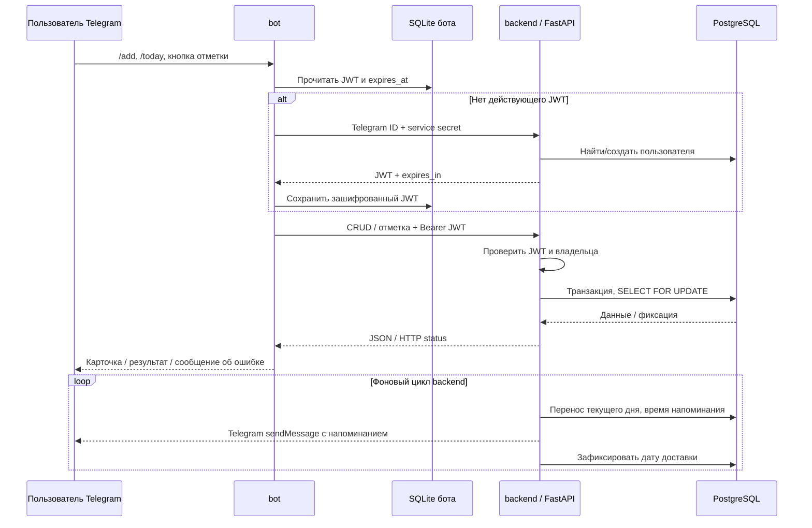

# Технические детали Habit Tracker

## Ответы на вопросы по аутентификации

### 1. Web / Swagger

`/docs` и OpenAPI-схема доступны локально для просмотра. Доступность документации не даёт доступ к данным: защищённые endpoints используют `HTTPBearer`, а Swagger показывает схему **UserAccessToken (HTTP, bearer, JWT)** и кнопку **Authorize**.

JWT можно получить через доверенного бота. Для локальной проверки оператором предусмотрен отдельный CLI, который не требует запущенного Telegram polling и не раскрывает внутренний service secret:

```sh
# Сначала запустить backend и PostgreSQL:
docker compose up -d --build backend
# Вместо 123456789 укажите свой Telegram ID; 123456789 допустим в отдельном учебном запуске.
docker compose run --rm --no-deps bot python -m scripts.issue_swagger_token --telegram-id 123456789
```

Команда выводит **короткоживущий JWT пользователя**. Скопируйте его, откройте http://localhost:8000/docs, нажмите **Authorize**, вставьте только JWT без слова `Bearer`, нажмите **Authorize → Close**. Swagger сам добавит `Authorization: Bearer <JWT>` к запросам. Не записывайте настоящий JWT на видео; для демонстрации используйте отдельный тестовый ID и дождитесь истечения токена либо удалите тестового пользователя.

CLI доступен только оператору с доступом к Docker и runtime secrets. Он может выбрать Telegram ID — это доверенный административный инструмент для локальной отладки, а не публичная регистрация или вход по одному ID. Не публикуйте `/auth/telegram` без ограничения доступа к машинному credential. Service secret никогда не вставляется в Swagger.

Без JWT API возвращает **401**. С истёкшим/подписанным другим ключом JWT — **401**. С валидным JWT другого владельца — **404**, включая чтение истории, изменение, удаление и отметку. Backend проверяет подпись HS256, `exp`, `iat`, `iss`, `aud`, `sub` и существование пользователя. Swagger не обновляет JWT автоматически: после истечения заново выполните CLI и повторите Authorize. На стороне бота перевыпуск автоматический.

### 2. Аутентификация пользователя из Telegram-бота

1. Telegram передаёт update боту через Bot API / long polling. Бот берёт идентификатор только из `message.from_user.id` / `callback.from_user.id`; ID нельзя ввести текстом вместо своей личности.
2. Бот работает только в личном чате. Проверяется соответствие chat ID и отправителя callback.
3. При отсутствии действующего JWT бот вызывает `POST /api/v1/auth/telegram`, передаёт ID и заголовок `X-Bot-Service-Secret`.
4. Backend проверяет отдельный секрет бота по Argon2id-хешу, создаёт/находит пользователя в PostgreSQL и выдаёт его JWT. Одного Telegram ID для входа недостаточно.
5. Все CRUD-запросы идут с пользовательским Bearer JWT; server-side проверка владельца обязательна для каждой операции.

Telegram BotFather token, внутренний service secret и пользовательский JWT — **три разных credential**, с разным назначением. Они не заменяют друг друга.

### 3. Собственная база и хранение токенов в боте

Словарь в памяти заменён на отдельную **SQLite-базу `tokens.sqlite3`**, принадлежащую боту. Она находится в volume `bot_data`, а не в PostgreSQL backend. SQLAlchemy создаёт схему версии 1 при старте хранилища. Таблица `user_tokens` содержит:

| Поле | Содержание |
|---|---|
| `telegram_identifier` | Ключ владельца JWT |
| `encrypted_access_token` | Шифротекст JWT, Fernet с контролем целостности |
| `expires_at` | Момент истечения, Unix timestamp UTC |
| `updated_at` | Момент сохранения, Unix timestamp UTC |

Исходный JWT не сохраняется в SQLite в открытом виде. Ключ шифрования генерируется один раз и хранится отдельно от базы, в закрытом `runtime_secrets`; его потеря требует получения новых токенов. На Linux у каталога базы права 0700, у файла 0600; приложение работает как UID 10001. После обычного перезапуска бота база и ключ сохраняются, действующий JWT используется повторно. Просроченные записи очищаются при сохранении нового JWT. Не публикуйте database/volume backups с credentials.

JWT нужно расшифровать для отправки Bearer-заголовка, поэтому его нельзя хранить только как односторонний хеш. Хешируются проверочные пароли/секреты; пользовательские токены в боте защищаются **шифрованием**.

### 4. Обновление после истечения JWT

Перед каждым запросом бот читает `expires_at` из своей базы. Если токен отсутствует, испорчен, не расшифровывается или до истечения осталось менее 30 секунд, бот повторяет доверенную аутентификацию, получает новый JWT и атомарно заменяет запись. Используется абсолютное время UTC, поэтому проверка работает после перезапуска процесса.

Если API неожиданно вернул **401**, бот удаляет отвергнутый JWT, получает новый и повторяет исходный запрос **один раз**. Повторный 401 передаётся пользователю как ошибка сервиса; бесконечного цикла нет. Это **перевыпуск access token через доверенный bot service secret**, отдельный refresh token не используется. При недоступном backend бот сообщает об ошибке и не отправляет запрос со старым истёкшим credential.

## Четыре контейнерных сервиса и последовательность общения

| Сервис Compose | Что делает | С кем общается |
|---|---|---|
| `initialize` | Одноразово создаёт секреты, ключ шифрования и права каталогов; при обновлении сохраняет прежние секреты | Записывает только `runtime_secrets` и подготавливает `bot_data`; после успешного выполнения завершает работу |
| `database` | PostgreSQL, хранит пользователей, привычки, дневные записи | Получает пароль из secret file; принимает SQL только от backend |
| `backend` | FastAPI, выдача/проверка JWT, CRUD, отметки, перенос; внутри него фоновый worker уведомлений | SQLAlchemy → PostgreSQL; HTTP → Telegram `sendMessage` для уведомлений |
| `bot` | pyTelegramBotAPI, MVP-интерфейс, диалоги и собственная SQLite-база JWT | Telegram Bot API → updates; SQLite → JWT; HTTP → backend |

Отдельного контейнера уведомлений **нет**: он реализован как фоновый worker backend, что разрешено исходным ТЗ. Сервис аутентификации также является слоем backend. `initialize` не является сервисом уведомлений; SQLite бота — отдельная база, но не отдельный контейнер.

Порядок запуска: **initialize завершился → PostgreSQL healthy → backend применил Alembic migrations и стал ready → bot стартовал**. Далее действуют два потока:



## Краткие примеры ввода и вывода

### Telegram: создание и отметки

```text
Пользователь: /add
Бот: Введите название привычки (до 120 символов).
Пользователь: Читать книгу
Бот: Описание до 1000 символов, или - для пустого описания.
Пользователь: 10 страниц
Бот: Дата начала: YYYY-MM-DD, или сегодня.
Пользователь: сегодня
Бот: Дата окончания: YYYY-MM-DD, или - без ограничения.
Пользователь: -
Бот: Привычка сохранена.
```

Карточка содержит название, описание, период, число выполнений и статус дня. Нажатие **Выполнено** меняет число с 0 на 1; повторное нажатие оставляет 1. Нажатие **Не выполнено** меняет 1 на 0. `/all` включает будущие и освоенные привычки; **История** показывает последние 100 дней. **Изменить** повторяет диалог со всеми полями; **Удалить** требует подтверждения.

### Swagger / API: создание

Запрос с действующим JWT в Authorize:

```http
POST /api/v1/habits
Authorization: Bearer <JWT>
Content-Type: application/json

{"title":"Читать книгу","description":"10 страниц","start_date":"2026-10-05","end_date":null}
```

Пример ответа **201 Created** (identifier зависит от базы):

```json
{"title":"Читать книгу","description":"10 страниц","start_date":"2026-10-05","end_date":null,"identifier":1,"completion_count":0,"completed":null,"record_date":null,"archived":false}
```

`GET /api/v1/habits` создаёт дневную запись и возвращает список с `record_date`. Для отметки отправьте `POST /api/v1/habits/1/completion` с `{"completed":true,"record_date":"2026-10-05"}`, подставляя **текущую локальную дату пользователя**, а не копируя пример в другой день. Ответ **200**, `completion_count: 1`, `completed: true`. Повтор не увеличивает счётчик.

### Нестандартные ситуации

| Ввод / действие | Результат |
|---|---|
| Запрос без Authorization / с просроченным JWT | 401 |
| Чужой identifier с валидным JWT | 404 |
| Пустое название / end_date раньше start_date | 422; в боте подсказка исправить ввод |
| Неизвестный часовой пояс | 422; диалог бота сообщает об ошибке |
| Нажатие вчерашней Telegram-кнопки | 409, новая дата не отмечается |
| Повтор «Выполнено» | Счётчик не увеличивается второй раз |
| Достижение лимита | Со следующего дня привычки нет в `/today`, история сохранена |
| Сбой Telegram при уведомлении | Повтор не ранее чем через 60 секунд, без вывода секретов в лог |
| Перезапуск бота | JWT остаётся в его базе, проверяется срок действия |
| Повреждённый шифротекст / заменённый ключ | Старый token удаляется, бот получает новый |

## Статус проекта

Реализованы API и Telegram-интерфейс, постоянное зашифрованное хранилище JWT, перевыпуск токенов, ежедневные отметки, напоминания и Docker Compose. Меню `/start`: Сегодня, Добавить привычку, Все привычки, Напоминания и Помощь; команды также доступны.

При аудите 11.10.2026: 47 unit/API-тестов прошли, 1 PostgreSQL-тест пропущен в SQLite-прогоне и успешно выполнен отдельно на PostgreSQL. Ruff lint/format, Poetry lock, применение/откат/повторное применение миграций и `alembic check` прошли. Результат CI виден в badge; проверки не являются утверждением о текущей доступности публичного сервиса.

Запись полной непрерывной демонстрации Telegram/API здесь не приложена. Сценарии сохранены: [DEMONSTRATION.md](../DEMONSTRATION.md), [VIDEO_GUIDE.md](../VIDEO_GUIDE.md). Описанный ниже цикл 06.10 — ранее зафиксированная проверка, а не новый live-тест доставки при этом аудите.

## Полный цикл проверки 06.10.2026

Обработчики Telegram проверены с реальным API, PostgreSQL и отправкой сообщений
в настоящий чат: CRUD, история, отметки, повтор, отмена, ошибки и авторизация.
Подтверждены перезапуск контейнера с сохранением JWT и перевыпуск реально
просроченного JWT. Фоновое уведомление доставлено в назначенную минуту.
Изменение настроек напоминаний заново активирует доставку; сохранение тех же
настроек сохраняет защиту от повторов. Пустой список не расходует напоминание.
Перенос на следующий день и лимит проверены на тестовом пользователе с заданным
временем и откатом транзакции. 47 тестов прошли локально; отдельный PostgreSQL
тест запускается в CI.

Это проверка обработчиков и сервисов, а не запись нажатий в Telegram.
Готов [пошаговый гайд для настоящей видеозаписи](../VIDEO_GUIDE.md):
каждый шаг содержит три действия и ожидаемый результат.
Пользователь самостоятельно записывает видео и отправляет куратору.
